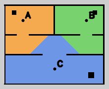

# Bài thực hành 7: Phân vùng bản đồ và điều hướng robot bằng giọng nói

**Môn học:** Tương tác người – robot (HRI)  
**Môi trường:** Ubuntu 22.04 · ROS 2 Humble · TurtleBot 4 Lite · Gazebo Fortress  
**Ngôn ngữ:** Python · **Nhận dạng:** Whisper large-v3 qua faster-whisper

## 1. Mục tiêu bài tập

Xây dựng hệ thống cho phép người dùng ra lệnh bằng tiếng Việt để robot di chuyển đến các khu vực đã gắn nhãn trên bản đồ. Luồng xử lý: **microphone → Whisper → văn bản trên `/voice_command` → phân tích hành trình → `NavigateToPose` → Nav2**.

| Yêu cầu | Cách thực hiện |
| --- | --- |
| Phân vùng bản đồ | Đọc Occupancy Grid, xác định ô trống và dùng BFS đa nguồn để lan nhãn từ ba điểm mẫu, không xuyên tường |
| Gắn nhãn ngữ nghĩa | Lưu ID, tên, alias và tọa độ đích của A/B/C trong YAML |
| Nhận dạng giọng nói | Ghi microphone, chuyển tiếng Việt thành văn bản với Whisper large-v3 |
| Điều hướng | Gửi từng đích cho Nav2; câu “từ A đến B” luôn thực hiện A trước B |
| Xử lý lệnh không hợp lệ | Kiểm tra toàn bộ hành trình trước khi gửi goal; từ chối nếu có vùng không tồn tại hoặc thiếu tên vùng |

Bản đồ và world được tạo mới từ cùng mô tả hình học: hai phòng A/B phía bắc, phòng thí nghiệm C phía nam, nối bằng hành lang. Đây là bản đồ hình học của mô phỏng, không phải bản đồ thu bằng SLAM. Tên phòng do người thiết kế gắn; thuật toán chưa tự suy ra chức năng phòng hoặc phát hiện cửa.



## 2. Cấu trúc thư mục

Nhánh `assignments_7` chứa trực tiếp nội dung workspace B7 ở thư mục gốc repository. Khi clone theo mục 3, thư mục làm việc được đặt tên là `b7`:

```text
b7/
├── README.md                      # Mục tiêu, cài đặt, chạy và xử lý lỗi
├── LICENSE                        # Giấy phép Apache-2.0
├── THIRD_PARTY.md                  # Nguồn và giấy phép bên thứ ba
├── .gitignore                     # Loại build, cache, model và dữ liệu kiểm thử
├── b7_env.bash                    # Nạp môi trường ROS riêng của B7
├── setup.sh                       # Cài Python, chuẩn bị runtime, build, tải model
├── setup_runtime.sh               # Build TF2 phiên bản tương thích trong B7
├── requirements.txt               # Thư viện Python được khóa phiên bản
├── regions.png                    # Ảnh ba vùng và điểm đích
├── src/b7_voice_nav/
│   ├── package.xml                # Khai báo dependency ROS 2
│   ├── setup.py                   # Đăng ký node, tài nguyên và prompt
│   ├── setup.cfg                  # Vị trí cài executable ROS 2
│   ├── resource/b7_voice_nav       # Đăng ký package với ament
│   ├── b7_voice_nav/
│   │   ├── common.py              # Chuẩn hóa câu, tìm vùng, đổi tọa độ
│   │   ├── segment.py             # Phân vùng ô trống bằng BFS đa nguồn
│   │   ├── navigator.py           # Gửi và theo dõi từng goal Nav2
│   │   ├── speech.py              # Ghi microphone và publish văn bản
│   │   ├── whisper_engine.py      # Nạp model và chuyển âm thanh thành chữ
│   │   ├── prompts/whisper_vi.txt # Prompt ngữ cảnh thực tế dùng cho Whisper
│   │   ├── map_markers.py         # Nhãn, điểm đích, lớp tô vùng tùy chọn
│   │   ├── simulator.py           # Quản lý Gazebo server/GUI
│   │   └── scan_throttle.py       # Giảm tần số scan dùng cho AMCL
│   ├── launch/
│   │   ├── sim.launch.py          # World B7 và robot TurtleBot 4
│   │   └── navigation.launch.py   # Map server, AMCL, Nav2 và RViz
│   ├── config/
│   │   ├── regions.yaml           # Tên, alias và pose đích A/B/C
│   │   ├── nav2.yaml              # AMCL, planner, controller và costmap
│   │   ├── map.rviz               # RViz có LiDAR và mô hình robot
│   │   ├── gazebo_gui.config      # Bố cục Gazebo GUI
│   │   └── fastdds_udp.xml        # DDS qua UDP loopback
│   ├── maps/
│   │   ├── map.yaml               # Resolution, origin và ngưỡng occupancy
│   │   └── map.pgm                # Ảnh bản đồ 2D
│   └── worlds/b7_campus.sdf       # World tương ứng bản đồ
└── tools/
    ├── generate_world_map.py      # Sinh đồng thời world và occupancy map
    ├── download_model.py          # Tải model theo revision đã khóa
    └── package_submission.py      # Đóng gói B7 thành ZIP
```

Sau cài đặt sẽ có thêm `.venv/`, `.runtime/`, `build/`, `install/`, `log/` và `models/whisper-large-v3/`. Các thư mục này phụ thuộc máy hoặc có dung lượng lớn nên không đưa lên Git. Model được tải lại bằng `setup.sh`; toàn bộ source, launch, config, prompt và dữ liệu bản đồ có trong repository.

Code kiểm thử, âm thanh mẫu, log và kết quả kiểm thử được giữ trên máy để tổng hợp báo cáo, không đưa vào nhánh nộp bài.

## 3. Cài đặt và chuẩn bị môi trường

### 3.1. Điều kiện

- Ubuntu 22.04, ROS 2 Humble đã cài tại `/opt/ros/humble`.
- Microphone được Ubuntu nhận diện; có giao diện đồ họa để mở Gazebo/RViz.
- Khuyến nghị GPU NVIDIA có 8 GB VRAM; máy kiểm thử dùng RTX 4060 8 GB.
- Có Internet ở lần cài đầu để tải dependency và model khoảng 3 GB. Sau khi tải xong, nhận dạng chạy tại máy.

Kiểm tra ROS và GPU:

```bash
ls /opt/ros/humble/setup.bash
nvidia-smi
```

Nếu dùng CPU, xem tham số thay thế ở mục 5.

### 3.2. Lấy mã nguồn và cài dependency hệ thống

Clone đúng nhánh vào thư mục mới. Nếu đã có thư mục `b7`, bỏ qua bước clone và làm việc trong thư mục hiện có.

```bash
mkdir -p ~/HRI
git clone --single-branch --branch assignments_7 \
  https://github.com/kieudung12/HRI_k68e-re.git ~/HRI/b7
cd ~/HRI/b7
```

```bash
sudo apt update
sudo apt install -y build-essential cmake python3-venv python3-pip \
  python3-colcon-common-extensions python3-opencv python3-yaml \
  libportaudio2 libasound2-plugins pulseaudio-utils git \
  ros-humble-turtlebot4-simulator ros-humble-navigation2 \
  ros-humble-nav2-bringup ros-humble-rmw-fastrtps-cpp
```

### 3.3. Chuẩn bị workspace

```bash
cd ~/HRI/b7
bash setup.sh
```

Script tạo `.venv`, cài dependency theo `requirements.txt`, chuẩn bị TF2 tương thích trong `.runtime`, build `b7_voice_nav`, tải model vào `models/whisper-large-v3` và tạo ảnh phân vùng. Không cần workspace của bài thực hành khác.

Model: [Systran/faster-whisper-large-v3](https://huggingface.co/Systran/faster-whisper-large-v3), thực thi qua [faster-whisper](https://github.com/SYSTRAN/faster-whisper). Revision tải được khóa trong [download_model.py](tools/download_model.py); thông tin nguồn và giấy phép ở [THIRD_PARTY.md](THIRD_PARTY.md).

### 3.4. Nạp môi trường ở mỗi terminal

```bash
cd ~/HRI/b7
source ./b7_env.bash
ros2 pkg prefix b7_voice_nav
```

Lệnh cuối phải trả về đường dẫn kết thúc bằng `b7/install/b7_voice_nav`. Chỉ `cd` vào thư mục chưa nạp môi trường. B7 dùng `ROS_DOMAIN_ID=97`; mỗi terminal cần source cùng file và không source workspace khác sau đó. Nếu đặt B7 ở vị trí khác, thay `~/HRI/b7` trong các lệnh bằng đường dẫn tương ứng.

### 3.5. Chuẩn bị microphone

Trong **Settings → Sound → Input**, chọn đúng microphone và thử thanh mức tín hiệu. Mặc định node dùng thiết bị `pulse`, tức đầu vào đang được Ubuntu chọn.

```bash
pactl get-default-source
python3 -c 'import sounddevice as sd; print(sd.query_devices())'
```

Giảm Input Volume nếu tín hiệu vỡ tiếng. Sau khi đổi microphone, dừng và chạy lại node nhận dạng.

## 4. Hướng dẫn chạy từng phần

### 4.1. Xem bản đồ và phân vùng

Bản đồ đã có sẵn trong repository. Để sinh lại ảnh phân vùng:

```bash
cd ~/HRI/b7
source ./b7_env.bash
ros2 run b7_voice_nav segment_map --output regions.png
```

World rộng 10 × 8 m; bản đồ có resolution 0,05 m/ô và origin `[-5.5, -4.5, 0]`. `segment.py` đọc `free_thresh`, lan nhãn qua các ô trống kề nhau và kiểm tra goal cùng vùng liên thông, cách vật cản/ô chưa biết ít nhất 0,22 m. `world_to_pixel` xử lý cả góc quay origin và chiều dọc ảnh.

| ID | Tên / cách gọi | x (m) | y (m) | yaw (rad) |
| --- | --- | ---: | ---: | ---: |
| A | Phòng A, phòng học | -3,20 | 2,40 | 1,57 |
| B | Phòng B, khu vực bê | 3,20 | 2,40 | 1,57 |
| C | Phòng thí nghiệm, khu vực xê | 0,00 | -2,50 | -1,57 |

Sửa tên, alias và goal trong [regions.yaml](src/b7_voice_nav/config/regions.yaml), sau đó khởi động lại node điều hướng và node hiển thị để nạp cấu hình. Nếu cần tạo lại world/map từ hình học, chạy `python3 tools/generate_world_map.py` rồi tạo lại `regions.png` trước khi mở mô phỏng.

### 4.2. Terminal 1 — Gazebo và TurtleBot 4

```bash
cd ~/HRI/b7
source ./b7_env.bash
ros2 launch b7_voice_nav sim.launch.py gui:=true
```

Robot spawn tại `(0, 0, yaw=0)`. Gazebo GUI mở sau khi có `/odom` và `/scan`. Chỉ chạy một phiên simulator B7; thêm `gui:=false` nếu không cần giao diện Gazebo.

### 4.3. Terminal 2 — AMCL, Nav2 và RViz

```bash
cd ~/HRI/b7
source ./b7_env.bash
ros2 launch b7_voice_nav navigation.launch.py
```

Chờ log `Managed nodes are active`; RViz cần báo **Navigation: active**, **Localization: active**. AMCL dùng pose khởi tạo trùng vị trí spawn. Nếu robot đã di chuyển trước khi mở localization, dùng **2D Pose Estimate** đặt lại vị trí và hướng hiện tại.

RViz hiển thị bản đồ đen/trắng, lưới 1 m, mô hình TurtleBot 4 và **LiDAR đỏ từ `/scan` bật mặc định**. Footprint màu xanh ngọc, đường toàn cục màu xanh dương và đường cục bộ màu cam. Nhãn A/B/C và các vòng tròn nhỏ đánh dấu đích.

Lớp tô màu vùng được bật tùy chọn tại **Region labels → Namespaces → region_floors**. Nhóm **Diagnostics** chứa costmap; việc ẩn chúng trên RViz không thay đổi cách Nav2 tránh vật cản. Thêm `rviz:=false` nếu chỉ cần các node điều hướng.

### 4.4. Terminal 3 — Node điều hướng bằng câu lệnh

```bash
cd ~/HRI/b7
source ./b7_env.bash
ros2 run b7_voice_nav voice_navigator --ros-args -p use_sim_time:=true
```

Node chờ văn bản trên `/voice_command`, kiểm tra đầy đủ tên vùng rồi gửi `NavigateToPose` trong frame `map`. Mỗi chặng phải thành công mới gửi chặng tiếp theo. Nếu Nav2 từ chối hoặc không hoàn thành goal, hành trình dừng. Lệnh mới bị bỏ qua khi robot đang thực hiện hành trình.

### 4.5. Terminal 4 — Nhận dạng giọng nói

```bash
cd ~/HRI/b7
source ./b7_env.bash
ros2 run b7_voice_nav speech_recognition
```

Chờ log `Whisper san sang`, sau đó:

1. Nhấn **Enter** để bắt đầu ghi âm.
2. Nói câu lệnh rõ ràng.
3. Nhấn **Enter** lần nữa để kết thúc ghi.
4. Kiểm tra dòng `Nghe duoc` và log `Đang gửi đích ...` ở terminal 3.
5. Chờ robot hoàn thành hành trình trước khi ghi lệnh tiếp theo.

Mỗi bản ghi tối đa 15 giây. Node in RMS/peak và cảnh báo nếu âm thanh quá nhỏ hoặc bị méo. Âm thanh chỉ được ghi khi nhấn Enter; đây không phải chế độ luôn lắng nghe.

| Câu lệnh | Hành trình mong đợi |
| --- | --- |
| “Đi đến khu vực A.” | A |
| “Di chuyển từ khu vực A đến khu vực B.” | A → B, kể cả khi robot đang ở vùng khác |
| “Đi đến phòng thí nghiệm.” | C |
| “Đi khu A rồi sang khu B rồi sang khu C.” | A → B → C |
| “Di chuyển đến khu vực A cho tôi.” | A |
| “Đi đến khu vực D.” | Báo vùng không tồn tại, không gửi goal |

Alias hỗ trợ cách đọc `bê`, `xê`, cách gọi ngắn `khu A` và các từ nối `qua`, `đến`, `tới`, `sang`, `rồi sang`, `sau đó sang`. Parser bỏ đuôi lịch sự như “cho tôi”, “giúp tôi với” trước khi tách hành trình; không suy đoán vùng thiếu hoặc sửa vùng không tồn tại thành vùng hợp lệ.

Prompt ngữ cảnh nằm trong [whisper_vi.txt](src/b7_voice_nav/b7_voice_nav/prompts/whisper_vi.txt), được `whisper_engine.py` đọc trực tiếp. Nội dung là `Câu lệnh điều hướng robot bằng tiếng Việt.` Prompt cung cấp ngữ cảnh cho Whisper; việc tìm vùng và sắp thứ tự điểm đến do parser Python thực hiện.

### 4.6. Trình diễn chức năng

Trình tự trình diễn đáp ứng yêu cầu bài tập:

1. Mở `regions.png`, xác định ba vùng và điểm đích trong YAML.
2. Nói “Đi đến phòng thí nghiệm”, chờ robot đến C.
3. Nói “Di chuyển từ khu vực A đến khu vực B”, kiểm tra robot đi A trước B từ vị trí C.
4. Nói “Đi đến khu vực A”, chờ robot đến A. Qua ba bước đã có ba câu giọng nói khác nhau.
5. Nói “Đi đến khu vực D”, kiểm tra lỗi và xác nhận không có goal mới.

Lưu bản chép, log từng goal và ảnh RViz/Gazebo trên máy để tổng hợp vào báo cáo. Không gửi thêm goal bằng RViz hoặc teleop trong lúc trình diễn hành trình giọng nói.

Nếu cần nộp thêm ZIP nguồn, chạy `python3 tools/package_submission.py --without-model --output b7_submission_source.zip`. Máy nhận chạy lại `bash setup.sh` để tạo môi trường và tải model.

## 5. Khắc phục sự cố thường gặp

| Hiện tượng | Cách xử lý |
| --- | --- |
| `Package 'b7_voice_nav' not found` | Chạy `cd ~/HRI/b7` rồi `source ./b7_env.bash` trong đúng terminal. Kiểm tra `ros2 pkg prefix b7_voice_nav`. Nếu chưa build, chạy `bash setup.sh`. Không source workspace khác sau B7. |
| Gazebo chưa hiện hoặc báo đã có server | GUI chờ `/odom` và `/scan`. Chỉ giữ một phiên `sim.launch.py`; dừng phiên cũ bằng Ctrl+C trước khi mở lại. Thử `gui:=false` để kiểm tra server riêng. |
| Không thấy LiDAR trong RViz | Bật **LiDAR**, topic `/scan`, QoS **Best Effort**. Dùng `ros2 topic hz /scan` kiểm tra dữ liệu; các terminal phải nạp cùng môi trường B7. Fixed Frame là `map`. |
| Node nhận dạng chưa ghi âm | Chờ `Whisper san sang`, nhấn Enter để bắt đầu và Enter lần nữa để kết thúc. Kiểm tra đầu vào ở Settings → Sound → Input; thử `-p device:=pulse`. |
| Âm thanh nhỏ, méo hoặc chép sai | Xem RMS/peak và cảnh báo; chọn đúng microphone, chỉnh Input Volume, nói gần mic, tránh tiếng nền. Sau khi đổi đầu vào, chạy lại node nhận dạng. |
| Báo chưa có model | Chạy lại `bash setup.sh`, hoặc `.venv/bin/python tools/download_model.py`. Kiểm tra `models/whisper-large-v3/model.bin`. |
| GPU thiếu VRAM | Chạy nhận dạng với `--ros-args -p compute_type:=int8_float16`; có thể tắt RViz hoặc Gazebo GUI để giảm tải. |
| Không có GPU/CUDA phù hợp | Dùng `--ros-args -p compute_device:=cpu -p compute_type:=int8`. Xử lý trên CPU chậm hơn; mặc định là CUDA FP16. |
| Nhận được chữ nhưng robot không đi | Xem terminal `voice_navigator`: lỗi tên vùng thì chưa gửi goal; `Nav2 chưa sẵn sàng` thì kiểm tra terminal 2; `Đang điều hướng` thì chờ hành trình hiện tại. Lệnh hợp lệ phải có log `Đang gửi đích ...`. |
| Robot định vị sai hoặc không lập được đường | Kiểm tra AMCL, map, TF và `/scan`; dùng **2D Pose Estimate** đặt pose thật nếu robot đã di chuyển trước khi mở localization. Không gửi đồng thời goal giọng nói, goal RViz và teleop. |
| Sửa Python/YAML nhưng node vẫn chạy hành vi cũ | Dừng và chạy lại node liên quan. Sau khi thay package, launch hoặc tài nguyên đóng gói, chạy `colcon build --base-paths src --packages-select b7_voice_nav --symlink-install` rồi source lại `b7_env.bash`. |
| Báo khu vực D không tồn tại | Đây là hành vi mong đợi. Vùng hợp lệ hiện tại là A/B/C; thêm vùng phải cập nhật tên/alias và một goal an toàn trong `regions.yaml`. |
