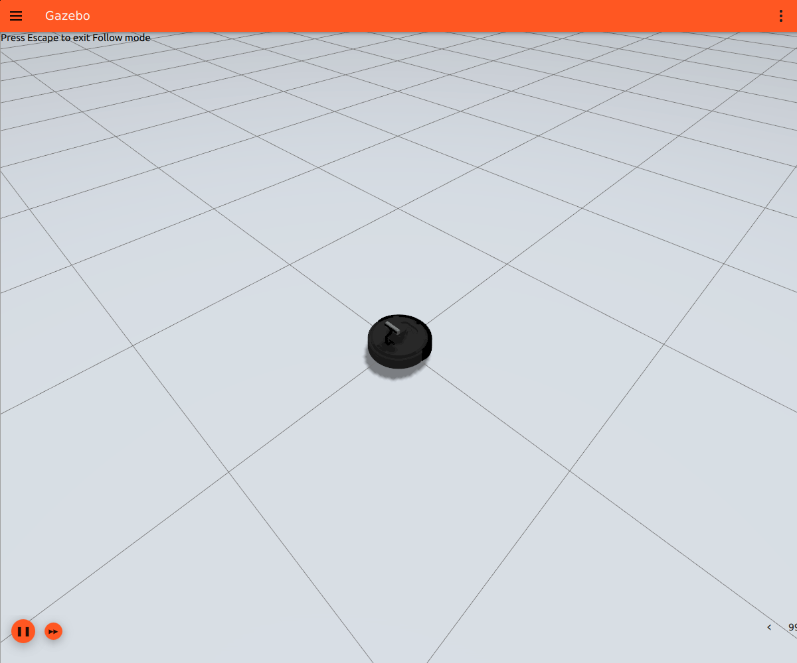
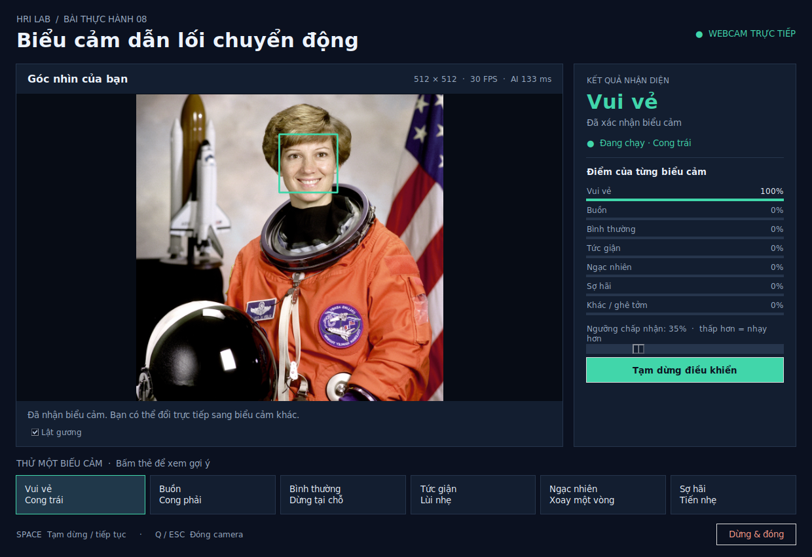

# Bài thực hành 08 — Nhận diện biểu cảm khuôn mặt và điều khiển TurtleBot

## 1. Mục tiêu bài tập

Xây dựng chương trình nhận diện biểu cảm qua webcam và điều khiển TurtleBot 4 bằng ROS 2 qua topic `/cmd_vel`. Camera hiển thị kết quả theo thời gian thực; Gazebo dùng sân trống để quan sát các quỹ đạo đơn giản.

Luồng xử lý:

```text
Webcam → DeepFace dò/căn chỉnh mặt → EfficientNet-B2 phân loại biểu cảm
       → hiệu chỉnh Neutral → làm mượt, xác nhận nhãn → /detected_emotion
       → node điều khiển + /odom → /cmd_vel → TurtleBot
```

| Biểu cảm | Hành động | Vận tốc thẳng `v` (m/s) | Vận tốc góc `ω` (rad/s) |
| --- | --- | ---: | ---: |
| Happy — Vui vẻ | Di chuyển cong trái | +0.12 | +0.35 |
| Sad — Buồn | Di chuyển cong phải | +0.12 | −0.35 |
| Neutral — Bình thường | Dừng tại chỗ | 0 | 0 |
| Angry — Tức giận | Lùi nhẹ trong 2 giây | −0.10 | 0 |
| Surprise — Ngạc nhiên | Xoay trái một vòng rồi dừng | 0 | +0.60 |
| Fear — Sợ hãi | Tiến nhẹ trong 2 giây | +0.10 | 0 |

DeepFace dùng bộ dò OpenCV để tìm và căn chỉnh khuôn mặt lớn nhất. Model HSEmotion/EmotiEffLib EfficientNet-B2 có sẵn phân loại 7 lớp bằng ONNX Runtime trên CPU; bài không huấn luyện lại model. `disgust` là lớp ngoài yêu cầu nên không tạo lệnh di chuyển. Có thể chọn model Emotion của DeepFace bằng tham số `classifier:=deepface`. Nguồn, giấy phép, revision và checksum model nằm trong [THIRD_PARTY.md](THIRD_PARTY.md).

Hai node ROS chạy độc lập: node camera có một worker AI, node điều khiển phát `Twist` ở 20 Hz. Bộ lọc làm mượt điểm bằng EMA và mặc định xác nhận sau 2 lần suy luận cùng nhãn, ngưỡng 35%. Không thấy mặt, kết quả cũ quá 1,5 giây hoặc mất thông điệp quá 2 giây thì robot dừng. Một khoảng điểm yếu/nghiêng sang nhãn mới được giữ tối đa 0,8 giây để giảm giật lệnh.

Quỹ đạo cong có bán kính khoảng `|v/ω| = 0,34 m`. Tiến/lùi dùng 2 giây đồng hồ thực, tương đương khoảng 20 cm khi mô phỏng chạy đúng tốc độ. Vòng xoay cộng delta yaw từ `/odom`, xử lý biên `+π ↔ −π`, dừng gần `2π` rad. Các chuyển động vẫn có sai số do thời gian mô phỏng, odometry và quán tính.

## 2. Cấu trúc thư mục

Nhánh `assignment_8` chứa trực tiếp nội dung workspace B8 tại thư mục gốc repository. Khi clone theo mục 3, thư mục trên máy được đặt tên là `b8`.

```text
b8/
├── README.md                        # Mục tiêu, cài đặt, chạy và xử lý lỗi
├── KIEM_THU.md                      # Kết quả và giới hạn kiểm tra
├── THIRD_PARTY.md                   # Nguồn và giấy phép model
├── LICENSE                          # Giấy phép mã nguồn Apache-2.0
├── requirements.txt                 # Phiên bản thư viện Python
├── setup.sh                         # Tạo venv, tải model, build package
├── b8_env.bash                      # Nạp môi trường ROS và overlay B8
├── .gitignore                      # Loại môi trường, model, cache và log
├── docs/
│   ├── webcam_ui.png                # Giao diện nhận diện
│   └── empty_world.png              # Sân trống trong Gazebo
└── src/b8_emotion_control/
    ├── package.xml, setup.py, setup.cfg
    ├── resource/b8_emotion_control
    ├── launch/
    │   ├── emotion_demo.launch.py   # Mô phỏng + controller + webcam
    │   └── sim.launch.py            # World B8, spawn robot, camera bám theo
    ├── worlds/b8_empty.sdf          # Chỉ có mặt sàn, không có vật cản
    ├── config/gazebo_gui.config     # Góc nhìn gần robot, lưới quan sát
    ├── b8_emotion_control/
    │   ├── recognition.py          # Dò mặt, tiền xử lý và suy luận
    │   ├── neutral_calibration.py  # Lấy mẫu mặt bình thường trong phiên
    │   ├── behavior.py             # EMA, ánh xạ vận tốc và điều kiện dừng
    │   ├── emotion_camera.py       # Webcam, worker AI, phát nhãn ROS
    │   ├── camera_view.py          # Giao diện Tkinter
    │   └── emotion_controller.py   # Nhãn + odometry → Twist
    └── test/
        ├── test_behavior.py
        └── test_neutral_calibration.py
```

Sau cài đặt có thêm `.venv/`, `models/`, `build/`, `install/`, `log/` và cache Python. Các thư mục này phụ thuộc máy hoặc chứa dữ liệu sinh ra nên không đưa lên Git; `setup.sh` tạo lại môi trường và tải model từ nguồn đã khóa phiên bản.

## 3. Cài đặt và chuẩn bị môi trường

### 3.1. Điều kiện

- Ubuntu 22.04, Python 3.10, ROS 2 Humble và công cụ `colcon`.
- TurtleBot 4 Simulator/Gazebo Fortress đã cài; webcam hoạt động trong phiên desktop.
- Workspace bài 4 `~/HRI/lec4` đã build và có package `lec4_robot_lab`. B8 dùng lại phần spawn TurtleBot, quản lý phiên Gazebo và môi trường ROS của bài này; world và giao diện Gazebo là tài nguyên riêng của B8.
- Đặt `lec4` và `b8` cạnh nhau. Không cần TensorFlow, CUDA hoặc GPU để chạy cấu hình mặc định.

Nếu thiếu công cụ Python:

```bash
sudo apt install python3-venv python3-pip python3-tk
```

Nếu chưa chuẩn bị ROS, simulator hoặc workspace `lec4`, hoàn thành phần cài đặt/build của bài 4 trước. Không cài `rclpy` bằng pip.

### 3.2. Lấy mã nguồn

Nếu đã có thư mục `~/HRI/b8`, bỏ qua bước clone và làm việc trong thư mục hiện có.

```bash
mkdir -p ~/HRI
git clone --single-branch --branch assignment_8 \
  https://github.com/kieudung12/HRI_k68e-re.git ~/HRI/b8
cd ~/HRI/b8
```

### 3.3. Chuẩn bị workspace

```bash
cd ~/HRI/b8
bash setup.sh
source ./b8_env.bash
ros2 pkg prefix b8_emotion_control
```

Script tạo `.venv` với `--system-site-packages` để dùng được thư viện ROS hệ thống, cài dependency, tải model khoảng 30 MB vào `models/enet_b2_7.onnx`, kiểm tra SHA-256 và build package. Lần cài đầu cần Internet; sau khi có model, suy luận chạy tại máy. Launch tự dùng Python của venv cho node AI; không cần activate venv khi chạy.

Mỗi terminal mới cần source `b8_env.bash`. File này kế thừa `ROS_DOMAIN_ID=92`, chế độ localhost và cấu hình DDS của `lec4`. Các terminal mô phỏng phải dùng cùng môi trường. Kết nối robot thật ở máy khác cần điều chỉnh mạng/DDS tương ứng.

### 3.4. Chuẩn bị webcam

```bash
ls /dev/video*
```

Đóng ứng dụng khác đang sử dụng webcam. Chọn nơi đủ sáng, chiếu sáng phía trước mặt; nhìn tương đối thẳng và chỉ để một người trong khung hình. Mặc định dùng camera `0`; thử `camera:=1` nếu cần đổi thiết bị.

## 4. Hướng dẫn chạy từng phần

### 4.1. Chạy nhanh toàn bộ hệ thống

```bash
cd ~/HRI/b8
source ./b8_env.bash
ros2 launch b8_emotion_control emotion_demo.launch.py
```

Launch mở sân trống Gazebo, TurtleBot, node điều khiển và webcam. Chờ dòng `Camera san sang`. Gazebo có góc nhìn gần và tự bám robot sau khi khởi động; lưới chỉ dùng quan sát, không tạo vật cản.



### 4.2. Chạy riêng mô phỏng

Terminal 1:

```bash
cd ~/HRI/b8
source ./b8_env.bash
ros2 launch b8_emotion_control sim.launch.py
```

World `b8_empty` chỉ có mặt sàn 200 × 200 m và ánh sáng; không có tường, bàn, hộp hay chướng ngại vật. Robot spawn ở tâm sân. Dùng `gui:=false` để chạy server không mở cửa sổ, hoặc `follow:=false` để giữ góc nhìn tự do. Trong cửa sổ Gazebo, **Esc** thoát chế độ bám camera; cuộn chuột để thay đổi độ gần.

### 4.3. Chạy webcam và điều khiển khi mô phỏng đã mở

Terminal 2:

```bash
cd ~/HRI/b8
source ./b8_env.bash
ros2 launch b8_emotion_control emotion_demo.launch.py sim:=false
```

Chỉ giữ một phiên mô phỏng và một bộ node điều khiển. Không chạy đồng thời teleop/Nav2 hay node khác phát `/cmd_vel`.



### 4.4. Lấy mẫu Bình thường và thao tác giao diện

1. Khi mới mở, giao diện báo **Chờ lấy mẫu**, robot đứng yên.
2. Nhìn thẳng, thả lỏng mặt và bấm nút xanh **Lấy mẫu Bình thường** hoặc nhấn **Space**.
3. Giữ khoảng 3 giây. Cần ít nhất 12 kết quả hợp lệ; robot dừng trong suốt quá trình lấy mẫu.
4. Chờ thông báo đã lấy mẫu. Sau đó đổi biểu cảm để điều khiển; dùng nhãn lớn phía trên làm kết quả điều khiển.

Hiệu chỉnh giúp xử lý trường hợp mặt thả lỏng bị model gốc nghiêng về Sad. Mẫu chỉ lưu vector điểm trong RAM của phiên chạy, không ghi ảnh và không huấn luyện lại. Mặt gần mẫu chuẩn được gán Neutral; khi thay đổi rõ, hệ thống dùng phần điểm tăng so với mẫu để chọn lệnh. Các thanh sau hiệu chỉnh là **điểm điều khiển**, không phải xác suất đã được kiểm định. Dòng **Model gốc: …** giúp so sánh với đầu ra AI trước hiệu chỉnh.

- **Tạm dừng / Space:** sau khi lấy mẫu, dừng hoặc tiếp tục điều khiển; camera vẫn hiển thị để tập biểu cảm.
- **Lấy lại mẫu:** dùng khi đổi góc nhìn hoặc ánh sáng. Giữ mặt bình thường lúc lấy mẫu.
- **Xóa mẫu:** xóa mẫu và giữ robot dừng; cần lấy mẫu lại để điều khiển.
- **Ngưỡng chấp nhận:** mặc định 35%; kéo thấp hơn chấp nhận điểm thấp hơn nhưng không tự sửa nhầm lớp của model.
- **Thẻ biểu cảm:** mở gợi ý tạo dáng; lệnh robot vẫn lấy từ khuôn mặt.
- **Lật gương:** đổi cách hiển thị webcam.
- **Q / Esc / Dừng & đóng** trong cửa sổ webcam: dừng và đóng camera. **Ctrl+C** trong terminal kết thúc launch.

Không khẳng định model luôn nhận đúng đủ 6 biểu cảm. Sad/Fear/Angry có thể nhầm nhau. Nếu hai dáng mặt cho cùng điểm model thì hiệu chỉnh cũng không tự phân biệt được; thử tư thế nhìn thẳng, ánh sáng ổn định và xem điểm từng lớp.

### 4.5. Trình diễn các hành động

Sau khi lấy mẫu, bắt đầu từ Bình thường; lần lượt thử Vui vẻ, Buồn, Tức giận, Sợ hãi và Ngạc nhiên. Trở về Bình thường giữa các lượt. Giữ mặt rõ trong lúc hành động chạy.

Happy/Sad chạy liên tục khi nhận được nhãn hợp lệ, có thể tiếp tục sau khi mặt được nhận lại. Angry/Fear/Surprise chỉ chạy một lần mỗi lần chọn biểu cảm; hoàn tất hoặc bị ngắt thì về Bình thường trước khi thử lại. Khi xoay, mất `/odom` quá 0,5 giây hoặc quá 60 giây chưa hoàn tất cũng dừng.

### 4.6. Tham số và kiểm tra topic

```bash
ros2 launch b8_emotion_control emotion_demo.launch.py \
  camera:=0 confidence:=35.0 stable_frames:=2 follow:=true
```

Có thể chọn `classifier:=deepface` để dùng DeepFace Emotion hoặc `detector:=retinaface` để dùng bộ dò CNN. Hai lựa chọn tải thêm model ở lần đầu: khoảng 6 MB và 112 MB tương ứng. `display:=false` tắt cửa sổ webcam; kiểm tra tự động không dùng giao diện lấy mẫu có thể thêm `require_calibration:=false` để dùng điểm model gốc.

Mỗi lệnh kiểm tra ở một terminal riêng đã source môi trường:

```bash
ros2 topic echo /detected_emotion
ros2 topic echo /emotion_robot_state
ros2 topic echo /cmd_vel
ros2 topic hz /odom
```

`/detected_emotion` và `/emotion_robot_state` dùng `std_msgs/msg/String`; `/cmd_vel` dùng `geometry_msgs/msg/Twist`; `/odom` dùng `nav_msgs/msg/Odometry`.

### 4.7. Kiểm thử logic

```bash
cd ~/HRI/b8
PYTHONPATH=src/b8_emotion_control python3 -m unittest discover \
  -s src/b8_emotion_control/test -v
```

Bộ kiểm thử gồm 21 trường hợp về hướng vận tốc, nhãn ổn định, nhiễu/mất mặt, vòng xoay và hiệu chỉnh Neutral. Đây là kiểm thử logic, không thay thế đánh giá nhận diện trên người thật. Kết quả và giới hạn kiểm tra ở [KIEM_THU.md](KIEM_THU.md).

## 5. Khắc phục sự cố thường gặp

| Hiện tượng | Cách xử lý |
| --- | --- |
| Không tìm thấy `b8_emotion_control` | Chạy `bash setup.sh`, source lại `b8_env.bash`; kiểm tra `ros2 pkg prefix b8_emotion_control`. |
| Không tìm thấy `lec4_robot_lab` | Đặt `lec4` cạnh `b8`, hoàn thành cài đặt/build bài 4 rồi source lại môi trường. |
| Không mở được webcam | Đóng ứng dụng đang dùng camera, kiểm tra `/dev/video*`, thử `camera:=1`. |
| Lỗi tải model/checksum | Kiểm tra mạng và chạy lại `bash setup.sh`; model tải theo revision/checksum đã khóa. |
| Giao diện báo Chờ lấy mẫu | Thả lỏng mặt và bấm nút xanh Lấy mẫu Bình thường; chờ hoàn tất khoảng 3 giây. |
| Mặt bình thường bị model gốc nhận Sad | Lấy mẫu Neutral, theo dõi nhãn lớn sau hiệu chỉnh. Dòng Model gốc vẫn có thể hiện Sad để đối chiếu. |
| Lấy mẫu không hoàn tất | Nhìn thẳng, giữ mặt trong khung, bổ sung ánh sáng; bấm lấy mẫu lại nếu quá 15 giây hoặc điểm dao động nhiều. |
| Không thấy mặt / nhãn `NONE` | Đưa mặt gần hơn, tránh ngược sáng và đợi nhãn ổn định. |
| Hành động không chạy lại | Với Angry/Fear/Surprise, về Bình thường được nhận ổn định rồi thử lại; kiểm tra không đang tạm dừng. |
| Surprise không xoay | Kiểm tra `/odom` có dữ liệu và mô phỏng đang chạy; về Bình thường rồi thử lại. |
| Robot đứng yên dù nhãn đã được nhận | Kiểm tra trạng thái tạm dừng, Gazebo không pause, `/cmd_vel` có subscriber; tắt node khác cùng điều khiển. |
| Gazebo báo đã có server | Dừng phiên cũ bằng Ctrl+C trước khi mở lại; chỉ giữ một phiên mô phỏng. |
| Muốn đổi góc nhìn Gazebo | Nhấn Esc trong Gazebo để thoát Follow, hoặc khởi động với `follow:=false`. |
| Thiếu Tkinter / không mở được cửa sổ | Cài `python3-tk`, dùng terminal desktop có `DISPLAY`. |
| Sửa code nhưng vẫn chạy bản cũ | Dừng launch, build lại bằng `colcon build --base-paths src --packages-select b8_emotion_control --symlink-install`, source `b8_env.bash` rồi chạy lại. |
